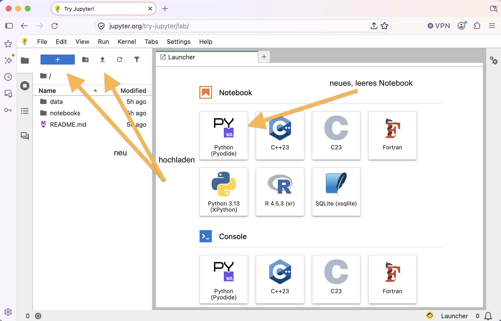
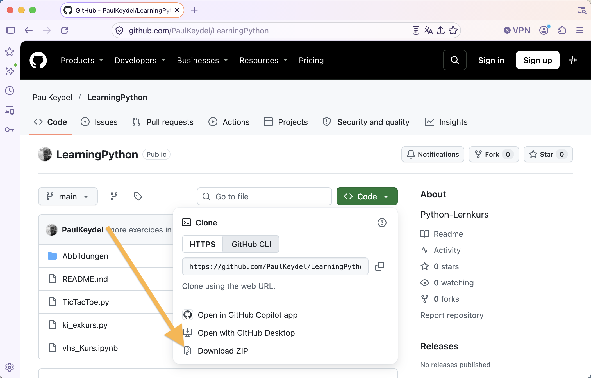

# Einführung in die Welt des Programmierens mit Python

## Willkommen
Zunächst erstmal herzlich willkommen in diesem Python-Lernkurs. Der Kurs richtet sich an Interessierte, die bisher keine oder sehr wenig Berührungspunkte mit Python oder Programmiersprachen generell hatten. Gemeinsam wollen wir in die grundlegende Logik hinter dem Programmieren eintauchen. Nicht nur theoretisch, auch praktisch beim Programmieren des Spiels **TicTacToe** (Drei-gewinnt).

## Was braucht man für den Kurs?
Wir arbeiten hier in einem **Jupyter-Notebook**. Wenn du Python und das Jupyter Package bereits auf deinem Computer installiert hast, kannst du das Jupyter Workbook von der *Eingabeaufforderung* aus starten.

Einfacher ist, die Online-Version von Jupyter zu nutzen. Dort kann mit dem Notebook programmiert werden, ohne dass Python auf deinem Computer intalliert sein muss. 

### Online programmieren

Für das Programmieren und das Nutzen von Jupyter Notebooks im Webbrowser eignet sich [Jupyter-Lab](https://jupyter.org/try-jupyter/lab/). Hier kannst du sowohl neue, leere Notebooks anlegen als auch bestehende Notebooks von deinem Rechner hochladen.

Es gibt allerdings auch **Einschränkungen** bei der Online-Variante: Komplexere Bibliothen von Python stehen nicht zur Verfügung, deshalb ist zum Beispiel das Programmieren von grafischen Oberflächen mit *Tkinter* nicht möglich. Das geht tatsächlich nur, wenn du Python selbst installiert hast.

### Python lokal installieren

Für die Installation von allen Kursvoraussetzungen unter *Windows* sind die folgenden Schritte abzulaufen:
1. Installieren der *Visual Studio Buildtools* [Download-Website](https://visualstudio.microsoft.com/downloads/)
2. Installieren von *Python* [Download-Website](https://www.python.org)
3. Jupyter über den Paketmanager installieren: `pip install notebook`

## Wie komme ich an die Arbeitsmaterialien?
Das Notebook und der Übungscode können aus diesem GitHub-Repository heruntergeladen werden.

Anschließend muss die Zip-Datei noch entpackt werden.

## Quellen
Die im Jupyter-Notebook verwedeten Bildquellen (sofern Abbildung nicht selbst erstellt ist):
* https://upload.wikimedia.org/wikipedia/commons/0/02/Compact_Muon_Solenoid_experiment.jpg
* https://upload.wikimedia.org/wikipedia/commons/1/1c/CMS_Higgs-event.jpg
* https://upload.wikimedia.org/wikipedia/commons/9/95/Google_data_center.jpg
* https://upload.wikimedia.org/wikipedia/commons/c/c6/John-Schappert-Netflix-Xbox-Live-E3-2009_%281%29.jpg
* https://upload.wikimedia.org/wikipedia/commons/7/77/Example_of_a_GUI.png
